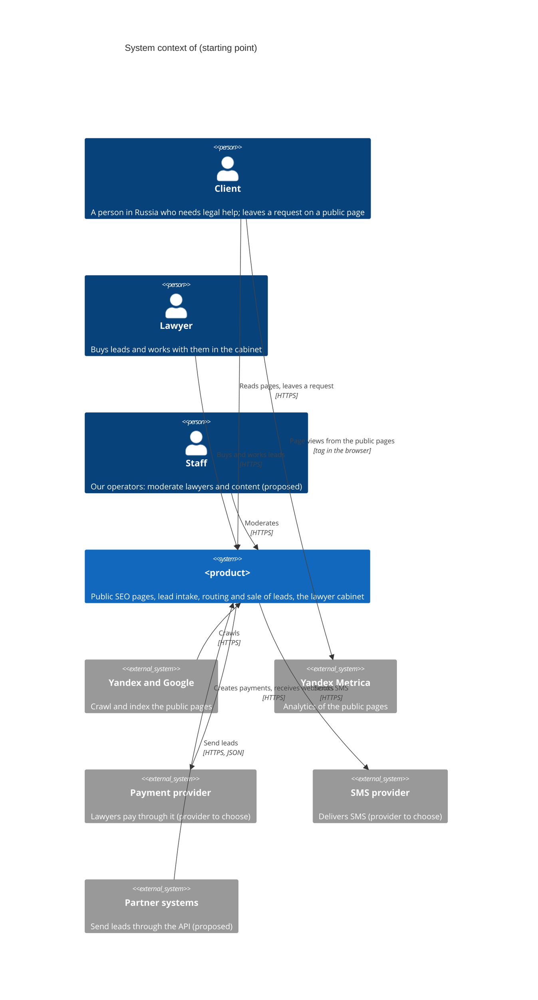
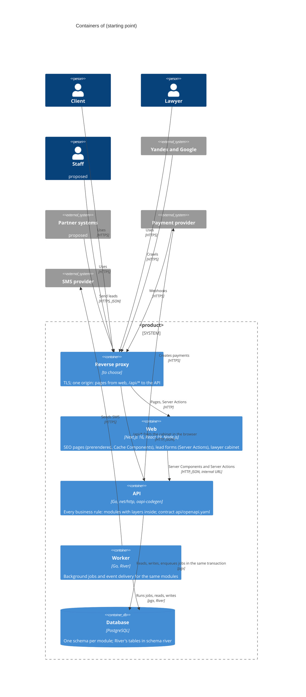

# C4: system context and containers

> Starting point from the ecc plugin. Elements marked *proposed* and the open questions need the
> team's confirmation; `<product>` is the product's name. Remove this note once settled.

Levels 1 and 2 of the C4 model (c4model.com). Level 3 (modules) is `context-map.md`; level 4 is
the code. Mermaid lays out C4 diagrams in the order the statements are written: if a diagram
renders cramped, reorder the statements.

## System context

## Containers

Constraints that shape the containers:
- Personal data of Russian users is stored and processed in Russia (152-FZ), backups and logs
  included; see the `security-review` skill.
- The browser reaches the API only through the same origin (`/api/*`), so the HttpOnly session
  cookie and cross-origin protection work without CORS (`STACK.md`).
- The API and the worker are two binaries of one Go module (`cmd/api`, `cmd/worker`). A module
  becomes a service of its own only for a measured reason (the `architect` agent's principles).

## Open questions

1. Is there a back office for staff (moderation of lawyers and content, disputes), and is it part
   of the cabinet or a separate area?
2. Which reverse proxy, which hosting in Russia, which payment and SMS providers? Each choice is an
   ADR.
