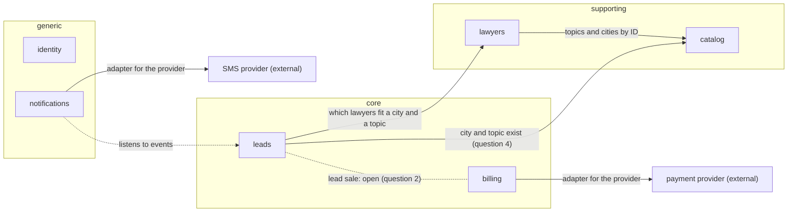

# Context map

> Starting point from the ecc plugin. Every relationship below is *proposed* or open; question
> numbers refer to `subdomains.md`. Confirm or correct them, then remove this note.

An arrow points from the module that depends (downstream: it calls or listens) to the module it
depends on (upstream). The arrows form a graph without cycles. A new arrow is an architecture
change: this file and the go-arch-lint configuration change together, in the same change.

How two modules meet (the same for every pair; the code patterns are in the
`go-clean-architecture` skill):
- **Synchronous**: the caller declares a port in its `usecase`; its `gateway/<other>` implements
  the port over `<other>/contract` and maps the answer into the caller's own types. The contract is
  the upstream's published API; the gateway is the caller's anti-corruption layer.
- **Asynchronous**: the upstream publishes a versioned event in its `contract`; a dispatcher in
  `platform` enqueues one job per subscriber in the same transaction; the subscriber's worker
  imports only the publisher's `contract`. The publisher doesn't know its subscribers.
- **Shared kernel**: `internal/kernel` (error kinds, a few universal value types). Keep it tiny.
- **Never**: another module's tables, entities or internal packages; a call to another module
  inside `Do`/`Update`; personal data copied into another module or into an event (events carry
  IDs, and the owner is asked when the data is needed).

| Downstream → upstream | How | What crosses | State |
|---|---|---|---|
| `leads` → `lawyers` | sync: a port in `leads/usecase`, `leads/gateway/lawyers` | lawyer IDs for a city and a topic | *proposed* |
| `leads` → `catalog` | sync, or a read-only copy fed by `catalog` events | city and topic IDs | open (question 4) |
| `lawyers` → `catalog` | sync | city and topic IDs | *proposed* |
| `leads` ↔ `billing` (lead sale) | one module owns the money invariant, a saga on River jobs, or a shared transaction | lead ID, lawyer ID, price snapshot | open (question 2) |
| `billing` → payment provider | a port of `billing`, an adapter for the provider; webhooks verified and processed idempotently | payment IDs, amounts | *proposed* |
| `notifications` → SMS provider | a port of `notifications`, an adapter for the provider | phone and text, at send time | *proposed* |
| `notifications` → modules whose events it handles | events; contact data read through the owner's `contract` when sending | IDs | *proposed*, per feature |
| `identity` → `notifications` | sync: sends the login codes (SMS, email) | phone or email, code | *proposed* (question 6) |
| modules that authorize → `identity` | conform: use the caller's user ID and role as `identity` defines them | user ID, role | *proposed* |
| web → API | the OpenAPI contract `api/openapi.yaml` and the client generated from it | JSON | decided (`STACK.md`) |
| partner systems → API | the same contract; `Idempotency-Key` when creating leads | leads | open (question 5) |

## Same word, different meaning

A term that means different things in two modules is listed here, so that neither module borrows
the other's model.

| Term | Meaning in one module | Meaning in the other |
|---|---|---|
| Lead (*proposed*) | `leads`: a client's request and its lifecycle | `billing`: what a lawyer pays for, with the price fixed at the sale |
